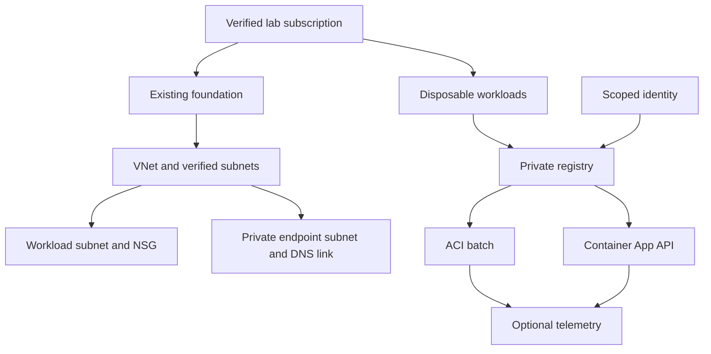

# Container lab preparation and evidence checklist

Design only: no deployment or completion is asserted.

## Objective
Evaluate a private image source, a batch container, and an API listening on port 8080 with a warm replica.

## Before execution
Confirm personal lab scope, region, quota, existing resources, image provenance/version and required permissions. Predict restart behavior after success/failure, ingress target-port behavior, scaling effects and image-pull failure causes before opening course solutions. Obtain explicit approval for exact resources, costs, lifetime, access changes, fault injection and cleanup.

## Execution and validation
Inspect existing registry repository/tag/digest. After approved creation, inspect ACI events, logs, process exit and restart behavior. Inspect Container App image/revision, ingress target port, min/max replicas and scale rules. Introduce an isolated fault only under approved scope; record hypotheses and evidence before revealing a solution. Recover and repeat the original functional test.

Microsoft qualifies Never restart behavior: successful exit does not restart, while some nonzero exits can still be restarted by the platform.

## Evidence requirements
Record dated sanitized configuration, source commit, predictions, actual test outputs, independent-versus-assisted performance, diagnosis, recovery, security/cost implications and cleanup results. Documentation does not establish hands-on completion.

## Architecture

Logical relationships only. Container Apps VNet integration may require a separate appropriately sized/delegated subnet. Verify overlap and deployed configuration before reuse.

## Cost and cleanup
Offline preparation adds no Azure usage. Cloud estimates must include region/SKU/runtime, registry tier/storage, vCPU/memory seconds, warm replicas, requests, logs, networking and egress. Budget alerts do not enforce spending caps. Keep exact scope and private billing details outside public documentation.

Maintain a created-versus-reused resource manifest. Obtain deletion approval; preserve reused resources. Verify remaining disks, public IPs, endpoints, registry, log retention and delayed charges after cleanup.

## Bicep follow-up
Review parameters, deployment scope, existing resources and implicit dependencies. Compile offline with available tools. Obtain scoped approval before cloud preview/deployment; compare actual resulting properties afterward. Preview does not prove runtime success.

## References
- [ACI restart policy](https://learn.microsoft.com/en-us/azure/container-instances/container-instances-restart-policy)
- [Container Apps billing](https://learn.microsoft.com/en-us/azure/container-apps/billing)
- [Container Apps scaling](https://learn.microsoft.com/en-us/azure/container-apps/scale-app)
